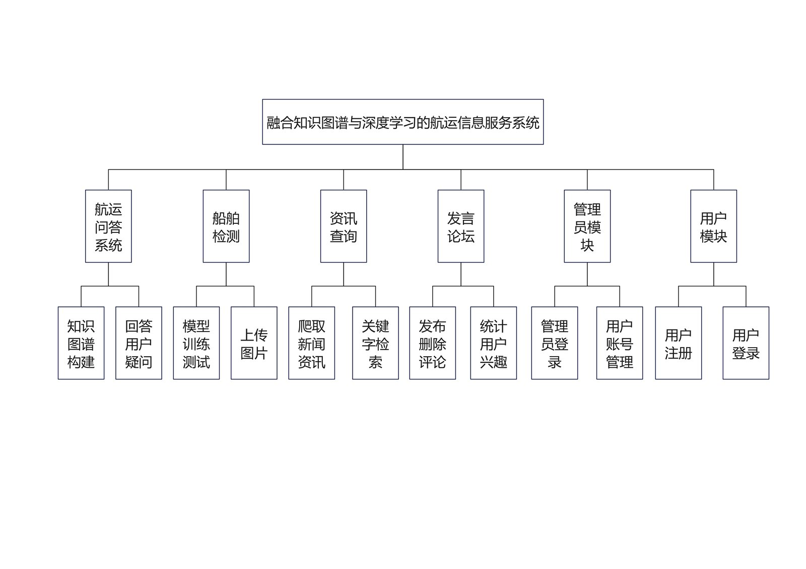
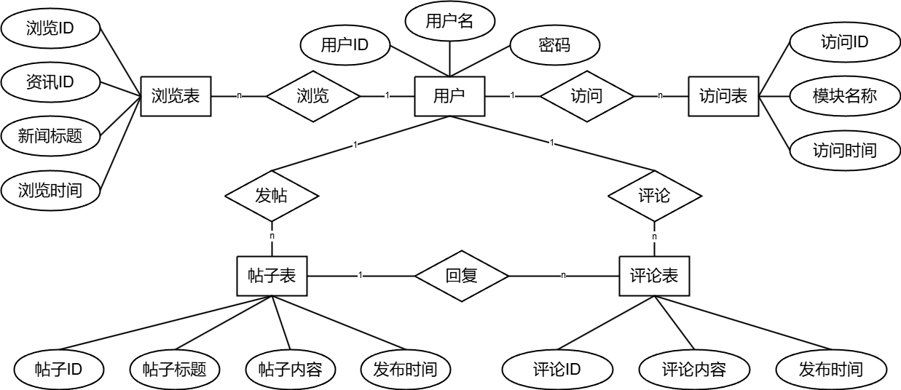
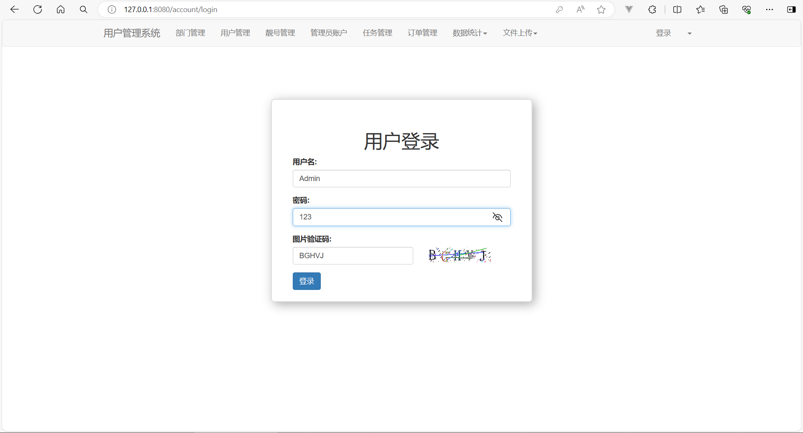
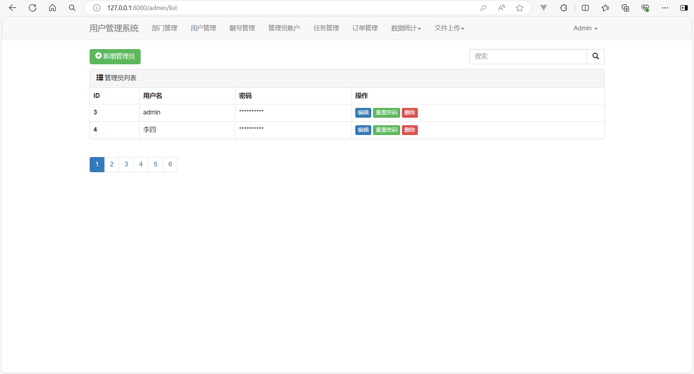
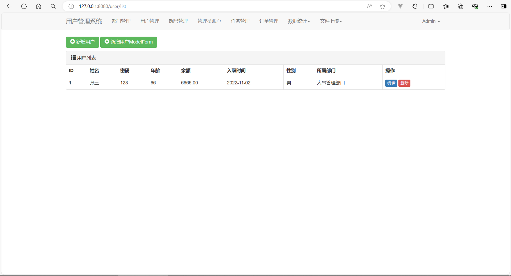
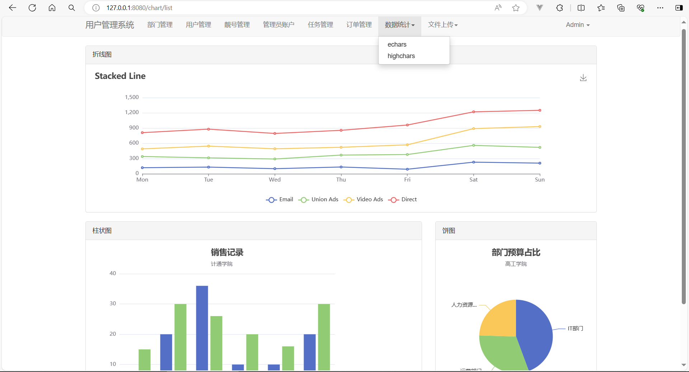
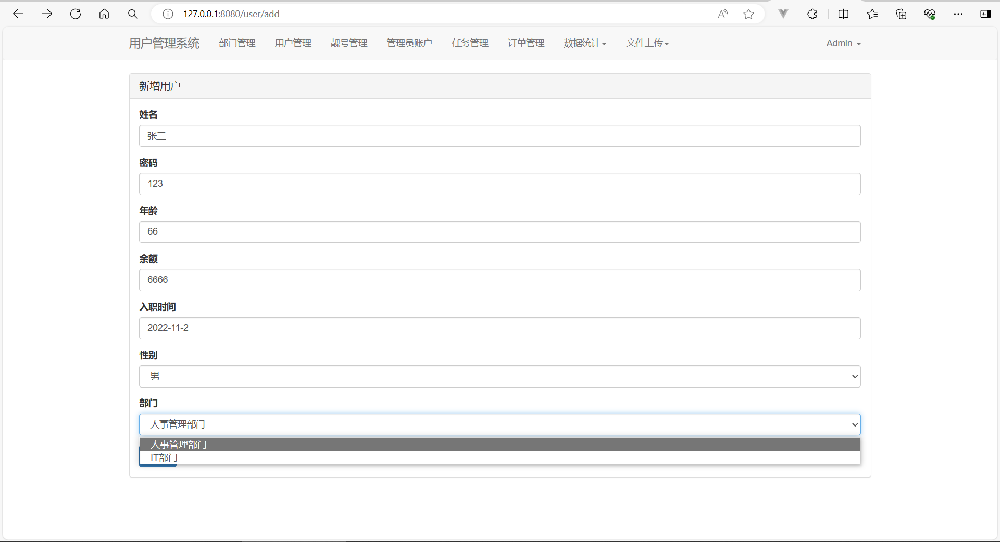
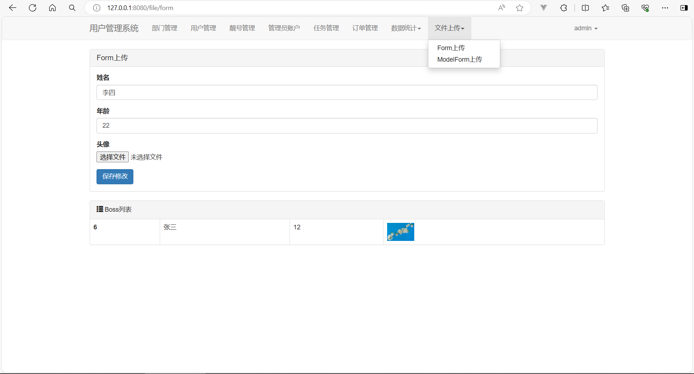

# 融合知识图谱的航运信息服务系统

一个面向航运领域的综合信息管理系统，集成了**用户管理、管理员系统、航运问答（知识图谱 + 大模型）、船舶识别（YOLO 深度学习）、资讯查询与推荐（爬虫 + BM25 检索 + 个性化推荐）、数据可视化、论坛**等功能。

> 本项目是一个 Django Web 项目，主程序位于 [`system/`](system/) 目录。`模块/` 目录存放各功能模块的开发源码（爬虫、模型训练、知识图谱构建等），`后端参考模板/` 为开发过程中的参考资料。

---

## 功能特性

| 模块 | 说明 | 对应论文章节 |
| --- | --- | --- |
| 航运问答 | 基于 Neo4j 港口知识图谱 + DeepSeek 大模型的自然语言问答 | 第 2 章 |
| 船舶识别 | 上传图片，使用 YOLO 模型识别船舶类型（货船/航母/邮轮/油轮/军舰） | 第 3 章 |
| 资讯查询与推荐 | MongoDB 存储，支持分页、关键字检索、BM25 全文检索、热门推荐、个性化推荐 | 第 4 章 |
| 用户系统 | 注册、登录（含图形验证码）、个人信息管理、Session 会话 | 第 5 章 |
| 管理员系统 | 管理员登录、增删改查、重置密码、权限中间件控制 | 第 5 章 |
| 数据可视化 | ECharts 图表展示模块访问量、用户统计、活跃度时段分布 | 第 5 章 |
| 论坛 | 发帖、评论、按热度/时间排序、权限控制 | 第 5 章 |

---

## 文档导航

项目文档按论文章节拆分为多个子文档，每个模块单独介绍其设计思路、技术实现与运行方式：

| 文档 | 内容 | 论文章节 |
| --- | --- | --- |
| [01 · 知识图谱问答系统](docs/01-知识图谱问答系统.md) | 港口知识图谱构建 + 自然语言问答（NER、意图识别、查询模板、大模型语义补全） | 第 2 章 |
| [02 · 深度学习船舶图像检测](docs/02-船舶图像检测系统.md) | 船舶数据集构建 + YOLO 模型训练与检测 | 第 3 章 |
| [03 · 资讯查询与推荐系统](docs/03-资讯查询与推荐系统.md) | 新闻爬虫 + BM25 全文检索 + 热门/个性化推荐 | 第 4 章 |
| [04 · 系统设计与数据库设计](docs/04-系统设计与数据库.md) | 系统分层架构、功能模块划分、MySQL/MongoDB/Neo4j 数据库设计 | 第 5 章 |
| [05 · 功能模块与界面展示](docs/05-功能模块与界面展示.md) | 各功能模块的使用说明与界面截图 | 第 5 章 |

---

## 系统预览

### 系统功能架构



### 数据库 ER 图



### 界面截图

| 登录界面 | 管理员页面 | 用户管理 |
| --- | --- | --- |
|  |  |  |

| 数据可视化 | 新增用户 | 头像上传 |
| --- | --- | --- |
|  |  |  |

> 更多流程图（船舶检测流程、问答系统流程）与模块截图见各子文档。

---

## 技术栈

- **后端**：Django（Python）
- **前端**：Bootstrap、ECharts、jQuery、Marked、highlight.js
- **数据库**：
  - **MySQL** —— 用户/管理员/论坛/访问记录等关系型数据（默认）
  - **MongoDB** —— 新闻资讯数据（可选）
  - **Neo4j** —— 港口知识图谱（可选）
- **AI / 算法**：
  - DeepSeek API（OpenAI 兼容接口）—— 问答大模型
  - Ultralytics / YOLO —— 船舶目标检测
  - BM25 + jieba / PyStemmer —— 新闻全文检索

---

## 目录结构

```
系统/
├── system/                     # ★ Django 主项目（可运行的 Web 演示）
│   ├── manage.py
│   ├── myProject/              # 项目配置（settings / urls / wsgi / asgi）
│   ├── app01/                  # 主应用
│   │   ├── models.py           # 数据模型
│   │   ├── views/              # 视图函数（account/user/admin/news/qa/ship/chart/forum/index/register）
│   │   ├── utils/              # 工具类（bm25、知识图谱、验证码、加密、分页等）
│   │   ├── middleware/         # 认证中间件
│   │   ├── templates/          # 页面模板
│   │   ├── static/             # 静态资源 + 船舶识别模型 ship_detection.pt
│   │   └── migrations/         # 数据库迁移
│   ├── media/                  # 上传文件（运行时生成，可不提交）
│   └── md_pic/                 # 系统截图（用于文档）
│
├── docs/                       # ★ 按模块拆分的详细文档
│   ├── 01-知识图谱问答系统.md
│   ├── 02-船舶图像检测系统.md
│   ├── 03-资讯查询与推荐系统.md
│   ├── 04-系统设计与数据库.md
│   └── 05-功能模块与界面展示.md
│
├── 模块/                        # ★ 各功能模块开发源码（按需上传）
│   ├── 新闻资讯爬取/             #   爬虫脚本，写入 MongoDB
│   ├── 港口信息爬取及构建知识图谱/ #   爬虫 + 构建 Neo4j 知识图谱（含 port_data.json）
│   ├── 船舶识别/                #   数据集（1.1GB）+ 训练脚本 + 训练结果
│   ├── 问答系统/                #   问答系统原型（独立 Django 项目）
│   └── 系统ER图.png
│
└── 后端参考模板/                # 参考资料（zip，无需上传）
```

---

## 快速开始（本地运行）

### 1. 环境要求

- Python 3.8+（推荐 3.10 / 3.11）
- **MySQL 5.7 / 8.0**（关系型数据库，必选）

**外部服务 MongoDB / Neo4j / DeepSeek 均为可选**，未配置时对应功能会自动降级（页面不会崩溃）：

| 服务 | 用途 | 未配置时的表现 |
| --- | --- | --- |
| MySQL | 用户/管理员/论坛等关系型数据 | 必选，需先创建数据库 |
| MongoDB | 新闻资讯数据 | 首页资讯数显示 0，新闻接口返回友好提示 |
| Neo4j | 知识图谱问答 | 问答自动回退为大模型直接回答 |
| DeepSeek API Key | 问答大模型 | 问答接口返回错误提示 |

### 2. 创建 MySQL 数据库

```sql
CREATE DATABASE django DEFAULT CHARACTER SET utf8mb4 COLLATE utf8mb4_general_ci;
```

### 3. 安装依赖

```bash
cd system
pip install -r requirements.txt
```

> 数据库驱动使用 `pymysql`（纯 Python 实现，Windows 下无需编译）。若希望改用 `mysqlclient`，请自行安装并保持 `.env` 中 `DB_ENGINE` 不变。

### 4. 配置环境变量（.env）

所有敏感配置（数据库密码、API Key）已改为从环境变量读取。复制示例配置并填入你自己的值：

```bash
cd system
cp .env.example .env      # Linux / macOS
# Windows 请用：copy .env.example .env
```

编辑 `.env`，填入 MySQL 连接信息（默认 `DB_ENGINE=mysql`），按需填入 MongoDB / Neo4j 连接信息和 DeepSeek API Key。`.env` 已被 `.gitignore` 忽略，不会上传到 GitHub。

### 5. 初始化数据库

```bash
cd system
python manage.py migrate
```

迁移会自动创建一个管理员账号：**用户名 `Admin`，密码 `123`**。

### 6. 准备数据（可选但推荐）

- **新闻数据**：运行 `模块/新闻资讯爬取/` 下的爬虫，把新闻写入 MongoDB（库 `news_db`，集合 `news_collection`）。详见 [03 · 资讯查询与推荐系统](docs/03-资讯查询与推荐系统.md)。
- **知识图谱数据**：运行 `模块/港口信息爬取及构建知识图谱/build_kg_utils.py`，将 `port_data.json` 导入 Neo4j。详见 [01 · 知识图谱问答系统](docs/01-知识图谱问答系统.md)。

### 7. 启动

```bash
cd system
python manage.py runserver
```

访问 http://127.0.0.1:8000/

---

## Docker 一键启动（可选）

项目提供了 `Dockerfile` 和 `docker-compose.yml`，可一键拉起 Django + MySQL + MongoDB + Neo4j 四个服务：

```bash
cd system
cp .env.example .env   # 先准备环境变量（填入 MySQL 密码等）
docker compose up --build
```

启动后访问 http://localhost:8000/，首次启动会自动执行数据库迁移。

> 提示：镜像会安装 Ultralytics/PyTorch，体积较大、首次构建较慢；新闻数据和知识图谱数据仍需通过 `模块/` 下的脚本导入。

---

## 线上部署（网页 Demo）

> ⚠️ **GitHub Pages 只能托管静态页面，无法运行 Django 后端**。要让他人直接在网页上使用，需要部署到能运行 Python/Django 的云平台。

### 推荐方案

| 平台 | 说明 | 成本 |
| --- | --- | --- |
| [Render](https://render.com) | 支持 Python Web 服务，部署简单，有免费额度 | 免费档可用 |
| [Railway](https://railway.app) | 一键部署，支持多服务（可同时跑 MySQL/MongoDB/Neo4j） | 免费额度有限 |
| [PythonAnywhere](https://www.pythonanywhere.com) | 专门托管 Django，支持 MySQL，适合初学者 | 免费档可用 |
| 宝塔面板 / VPS | 自建服务器，灵活度最高 | 需一台服务器 |

> 本项目已附带 [render.yaml](system/render.yaml)，把仓库连接到 Render 后可一键创建 Web 服务。Render 原生无 MySQL，需搭配 Aiven / PlanetScale / ClearDB 等外部 MySQL，以及 MongoDB Atlas、Neo4j Aura 等托管服务使用。

### 部署说明

- **MySQL**：正式使用需提供外部 MySQL 实例，通过环境变量注入连接信息。
- **MongoDB / Neo4j**：用托管服务（如 MongoDB Atlas、Neo4j Aura），通过环境变量注入连接信息。
- **DeepSeek API Key**：通过平台环境变量注入，**不要把 Key 提交进仓库**。
- **船舶识别模型**：`ship_detection.pt`（约 5.3MB）可直接提交；但 Ultralytics 依赖 PyTorch，镜像体积较大。

---

## 文件上传清单（哪些需要上传到 GitHub）

### ✅ 需要上传

| 文件/目录 | 原因 |
| --- | --- |
| `system/`（整个 Django 项目） | 核心可运行代码 |
| `system/app01/static/models/ship_detection.pt` | 船舶识别模型，demo 必需 |
| `system/md_pic/` | 文档截图，README 展示用 |
| `docs/` | 按模块拆分的详细文档 |
| `模块/新闻资讯爬取/` | 新闻数据来源脚本（体积小） |
| `模块/港口信息爬取及构建知识图谱/` | 知识图谱构建脚本 + `port_data.json`（1.1MB） |
| `模块/问答系统/`（除 `db.sqlite3`） | 问答原型参考代码 |
| `模块/系统ER图.png` | 文档用图 |

### ❌ 不需要上传（或需排除）

| 文件/目录 | 原因 |
| --- | --- |
| `模块/船舶识别/数据集获取/` | **约 1.1GB** 数据集，远超 GitHub 单仓库建议体积 |
| `模块/船舶识别/训练结果/` | **约 29MB** 训练产物（权重、图表、TensorBoard 日志） |
| `后端参考模板/`（3 个 zip） | 参考资料，与运行无关 |
| `其它/`（论文、查重报告、签名等） | 含个人隐私信息，勿上传（有用架构图已提取到 `system/md_pic/`） |
| `*.sqlite3`、`__pycache__/`、`.idea/`、`media/`、`.env` | 运行产物 / IDE 文件 / 密钥 |

> 建议做法：**只把本仓库（`系统/` 目录）整体上传**，`system/` 是唯一可运行的 demo，`模块/` 中的爬虫与构建脚本作为源码保留，`船舶识别` 的大数据集和训练结果用 `.gitignore` 排除。

---

## 安全注意事项（重要）

已将所有敏感配置改为从环境变量 `.env` 读取（`.env` 已被 `.gitignore` 忽略，不会上传到 GitHub）：

- ✅ MySQL 密码 → `DB_PASSWORD`
- ✅ DeepSeek API Key → `OPENAI_API_KEY`
- ✅ Neo4j 密码 → `NEO4J_PASSWORD`
- ✅ MongoDB / 数据库连接信息 → 对应环境变量

> ⚠️ 特例：`SECRET_KEY` 参与了密码加盐（见 `app01/utils/encrypt.py`），更换会导致已注册用户 / 默认管理员密码失效，因此保留为默认值。**正式上线时请通过 `DJANGO_SECRET_KEY` 覆盖，并重置相关账号密码。**

部署到线上时，请务必在平台注入环境变量、设置 `DJANGO_DEBUG=False`、配置 `DJANGO_ALLOWED_HOSTS`。

---

## 默认账号

| 角色 | 用户名 | 密码 |
| --- | --- | --- |
| 管理员 | `Admin` | `123` |

普通用户可自行在「注册」页面创建。

---

## 常见问题

1. **验证码字体**：已内置多平台字体回退（Windows / Linux / macOS），一般无需配置；极端情况下会回退到 PIL 默认字体，不影响使用。
2. **Neo4j 连接失败**：知识图谱问答会自动降级为大模型直接回答，不影响其他功能。如需完整的知识图谱问答，请确认已开启 Bolt 端口（默认 7687）并导入港口数据。
3. **新闻显示为空**：确认 MongoDB 已启动且 `news_db.news_collection` 有数据（可用 `模块/新闻资讯爬取/` 爬取）。
4. **MySQL 连接失败**：确认 `.env` 中 `DB_NAME / DB_USER / DB_PASSWORD / DB_HOST / DB_PORT` 正确，且已执行 `CREATE DATABASE django`。

---

## 可改进的点（Roadmap）

### 安全

- [ ] 密码改用 Django 内置的 `make_password` / `check_password`（PBKDF2），替代当前的 MD5 加盐，提升强度
- [ ] 生产环境务必覆盖 `SECRET_KEY`、关闭 `DEBUG`、收紧 `ALLOWED_HOSTS`
- [ ] 问答 / 船舶识别等接口补充 CSRF 校验与请求限流，防止被刷（消耗 API 费用 / 算力）
- [ ] 知识图谱问答对 DeepSeek 生成的 Cypher 语句做校验 / 白名单，降低注入风险

### 架构与可维护性

- [ ] 视图层拆分出 service 层，当前业务逻辑与数据访问耦合较重
- [ ] 船舶识别模型改为启动时全局加载一次并缓存，避免每次请求重新 `YOLO()` 加载
- [ ] BM25 检索改为索引化 / 增量更新，避免每次全量加载所有新闻到内存
- [ ] 前端 CDN 依赖（Bootstrap / ECharts / jQuery）本地化，兼容离线与内网环境
- [ ] 补充单元测试（当前 `tests.py` 为空）

### 功能

- [ ] 新闻资讯支持更多筛选 / 排序条件与关键词高亮
- [ ] 论坛增加分页、搜索、点赞等交互
- [ ] 图片上传增加大小 / 类型校验
- [ ] 问答支持多轮对话上下文

### 部署

- [ ] 生产环境为 MySQL 配置主从 / 备份策略
- [ ] 船舶识别可拆分为独立推理服务，避免 PyTorch 拖大主应用镜像
