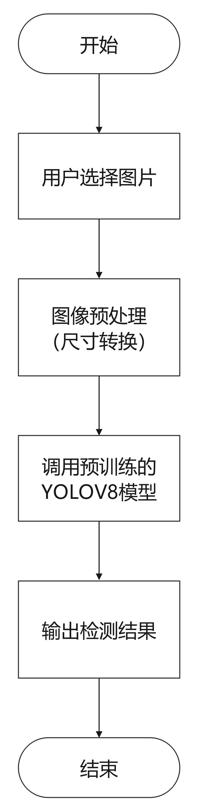

# 深度学习船舶图像检测系统（论文第 3 章）

> 本章对应论文第 3 章「深度学习船舶图像检测设计与实现」，介绍船舶图像数据集的构建、YOLO 目标检测模型的训练与评估，以及检测功能在 Web 系统中的集成。

---

## 1. 模块概述

船舶识别模块允许用户上传一张船舶图片，系统调用训练好的 YOLO 模型进行目标检测，返回检测到的**船舶类型、置信度与标注框**，并在图片上绘制检测结果。

---

## 2. 数据集构建

船舶数据集存放在 [`模块/船舶识别/数据集获取/`](../模块/船舶识别/数据集获取/)（约 1.1GB，已通过 `.gitignore` 排除上传），来源包括：

| 来源 | 脚本 | 说明 |
| --- | --- | --- |
| 公开数据集 | `公开数据集FastRCNN-Update.v2i.yolov11/` | 公开船舶数据集，已转为 YOLO 格式 |
| 网络爬取 | [`spider.py`](../模块/船舶识别/数据集获取/spider.py) | 爬取补充图片 |

数据预处理脚本 [`resize.py`](../模块/船舶识别/数据集获取/resize.py) 用于统一图片尺寸，`count.py` 用于统计各类别样本数量。

## 3. 船舶类别

系统共检测 5 类船舶（见 [`模块/船舶识别/训练结果/类别.txt`](../模块/船舶识别/训练结果/类别.txt)）：

| 类别名（模型） | 中文 | 说明 |
| --- | --- | --- |
| `Cargo` | 货船 | 运输货物的商船，包括散货船、集装箱船等 |
| `Carrier` | 航空母舰 | 搭载飞机、执行军事任务的军舰 |
| `Cruise` | 邮轮 | 用于旅游的客船，外观豪华，适合远洋旅行 |
| `Tanker` | 油轮 | 运输液体货物（原油、化学品、液化天然气等） |
| `Warship` | 军舰 | 军事用途，包括驱逐舰、护卫舰、潜艇等 |

## 4. 模型训练与评估

- **模型**：YOLO（Ultralytics，YOLOv8/YOLOv11 系列），目标检测单阶段算法。
- **训练**：使用 Ultralytics 的 `train` 接口在船舶数据集上训练。
- **评估**：以 mAP（平均精度均值）、精确率、召回率等指标评估检测效果。
- **训练产物**：保存在 [`模块/船舶识别/训练结果/`](../模块/船舶识别/训练结果/)（含 `detect.py` 推理脚本、类别说明、权重与评估图表，已排除上传）。
- **推理脚本**：[`detect.py`](../模块/船舶识别/训练结果/detect.py)。

最终部署到 Web 系统的模型权重为 [`system/app01/static/models/ship_detection.pt`](../system/app01/static/models/ship_detection.pt)（约 5.3MB）。

---

## 5. 系统集成（`app01/views/ship.py`）

主接口 `detect_ship`（对应路由 `POST /ship/detect`）的处理流程：

1. 接收前端上传的图片（`request.FILES`）。
2. 保存为临时文件（UUID 命名）。
3. 加载模型 `YOLO(MODEL_PATH)` 并调用 `model.predict()` 推理。
4. 从推理结果中解析每个检测框的 `xyxy` 坐标、类别 `cls`、置信度 `conf`。
5. 通过类别映射 `SHIP_CLASS_MAP` 与描述 `SHIP_CLASS_DESC` 转为中文结果。
6. 返回标注后的图片路径与检测结果列表。

相关路由：

| 路由 | 功能 |
| --- | --- |
| `GET /ship/identify` | 船舶识别页面 |
| `POST /ship/detect` | 上传图片并检测 |

> 测试结果示例：上传邮轮图片，模型返回 `Cruise`（邮轮）类别，置信度约 90.9%。

---

## 6. 运行前提

| 依赖 | 说明 |
| --- | --- |
| `ultralytics` / `opencv-python` | YOLO 推理与图像处理 |
| 模型文件 `ship_detection.pt` | 需位于 `app01/static/models/` |

> 首次请求会加载 PyTorch 模型，耗时略长。

---

## 7. 可改进点

- 模型每次请求都重新 `YOLO()` 加载，建议启动时全局加载并缓存。
- 未对上传图片做大小/类型校验，建议限制文件大小与格式。
- 检测服务可拆分为独立推理服务，避免 PyTorch 拖大主应用镜像。
