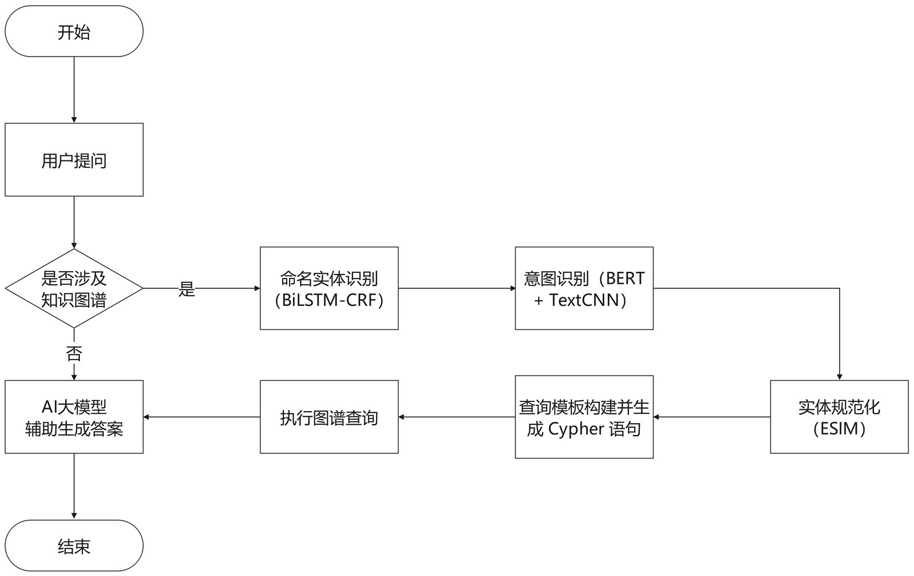

# 功能模块与界面展示（论文第 5 章）

> 本章对应论文第 5 章「系统设计与展示」中的 5.3 界面展示，逐一介绍各功能模块的使用方式与界面截图。

---

## 1. 用户模块

**功能：** 用户注册、登录、退出、个人信息管理、头像上传。

- 注册时需填写用户名、密码并输入图形验证码（验证码由 [`app01/utils/code.py`](../system/app01/utils/code.py) 生成，含随机字符、干扰点、干扰线）。
- 登录后 Session 保存用户信息，支持个人头像上传。

| 登录界面 | 用户管理 | 头像上传 |
| --- | --- | --- |
|  |  |  |

---

## 2. 管理员模块

**功能：** 管理员登录、用户/管理员增删改查、密码重置。

- 默认管理员账号：`Admin / 123`。
- 管理员登录后进入数据统计页，可管理用户列表、新增用户等。

| 管理员页面 | 新增用户 |
| --- | --- |
|  |  |

---

## 3. 航运问答模块

**功能：** 基于港口知识图谱 + DeepSeek 大模型的自然语言问答。

- 输入航运相关问题（如「上海有哪些港口」），系统优先查询知识图谱，必要时回退大模型直接回答。
- 详见 [01 · 知识图谱问答系统](01-知识图谱问答系统.md)。

---

## 4. 船舶识别模块

**功能：** 上传船舶图片，识别船舶类型并绘制检测框。

- 支持 5 类船舶：货船、航空母舰、邮轮、油轮、军舰。
- 详见 [02 · 深度学习船舶图像检测](02-船舶图像检测系统.md)。

---

## 5. 资讯查询模块

**功能：** 新闻列表、关键字/日期检索、BM25 全文检索、热门推荐、个性化推荐。

- 首页展示热门关键词，列表支持分页、排序、日期过滤。
- 登录用户可查看浏览历史与个性化推荐。
- 详见 [03 · 资讯查询与推荐系统](03-资讯查询与推荐系统.md)。

---

## 6. 发言论坛模块

**功能：** 发帖、评论、按热度/时间排序、删除。

- 登录用户可发布帖子、评论帖子，作者可删除自己的内容。
- 数据模型：`Post`（帖子）、`Comment`（评论），见 [04 · 系统设计与数据库](04-系统设计与数据库.md)。

---

## 7. 数据可视化模块

**功能：** 使用 ECharts 展示系统的模块访问量、用户统计、活跃度时段分布。

- 数据来源为 `ModuleVisit`（模块访问记录）与 `UserInfo`（用户表）。
- 提供折线图、饼图、柱状图、堆叠图等多种图表。

---

## 8. 页面路由总览

| 模块 | 路由 | 说明 |
| --- | --- | --- |
| 首页 | `/` | 系统首页 |
| 用户 | `/user/login`、`/user/register`、`/user/logout` | 登录/注册/退出 |
| 用户 | `/user/list`、`/user/add`、`/user/<id>/edit`、`/user/<id>/del` | 用户管理 |
| 管理员 | `/admin/login`、`/admin/logout` | 管理员登录/退出 |
| 管理员 | `/admin/list`、`/admin/add`、`/admin/<id>/edit`、`/admin/<id>/reset` | 管理员管理 |
| 问答 | `/qa`、`/qa/ask` | 问答页面/接口 |
| 船舶 | `/ship/identify`、`/ship/detect` | 船舶识别页面/接口 |
| 资讯 | `/news/list`、`/news/api/*`、`/news/recommended` | 资讯列表/接口/推荐 |
| 可视化 | `/chart/list`、`/chart/*` | 数据统计 |
| 论坛 | `/forum/list`、`/forum/post/*` | 论坛 |
